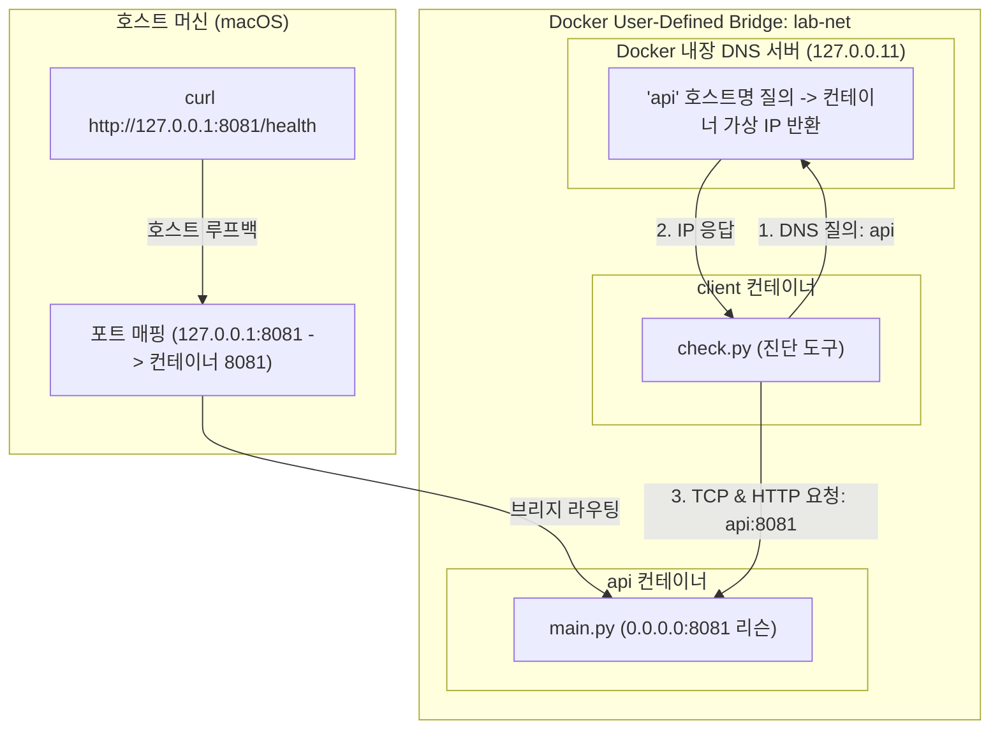

# 07단계: Docker Multi-Container Networking Lab

## 1. 개요 및 학습 목표
- **학습 주제**: Docker Compose, 사용자 정의 브리지 네트워크(User-defined Bridge Network), 내장 DNS(Service Discovery), 포트 포워딩(Port Forwarding), 헬스체크(Healthcheck)
- **비용**: 0원 (Mac 로컬 Docker Desktop 환경)
- **목표**:
  1. 단일 컨테이너를 넘어 복수 개의 컨테이너(`api`, `client`)를 `compose.yaml`로 선언적으로 오케스트레이션합니다.
  2. Docker 내장 DNS(`127.0.0.11`)가 서비스 이름(`api`)을 내부 가상 IP(VIP)로 자동 변환(Service Discovery)하는 과정을 검증합니다.
  3. 컨테이너 내부 통신(`api:8081`)과 호스트(Mac)에서의 접근(`127.0.0.1:8081`)의 차이 및 보안 격리 구조를 이해합니다.

---

## 2. 프로젝트 파일 구성
```text
07-compose-network/
├── api/
│   ├── Dockerfile         # Python 3.12-slim 기반 가벼운 HTTP 서버 이미지
│   └── main.py            # 0.0.0.0:8081 대기, /health JSON 응답 제공 (ThreadingHTTPServer)
├── client/
│   ├── Dockerfile         # 네트워크 진단 스크립트 실행 이미지
│   └── check.py           # socket.getaddrinfo(DNS), socket.create_connection(TCP), urlopen(HTTP) 순차 진단
├── compose.yaml           # bridge 네트워크 'lab-net', 포트 매핑, 헬스체크, 의존성(depends_on) 정의
├── test_local.py          # 로컬 Python 환경에서 DNS/TCP/HTTP 및 에러 처리를 검증하는 자동화 단위 테스트
└── README.md              # 실습 안내서
```

---

## 3. 핵심 아키텍처 및 통신 경로



---

## 4. 로컬 및 Docker 실행 방법

### 4.1 로컬 단위 테스트 실행 (Mac zsh)
```zsh
cd 07-compose-network
python3 -m unittest -v test_local.py
```

### 4.2 Docker Compose 빌드 및 백그라운드 실행
```zsh
docker compose up -d --build api
docker compose ps
```

### 4.3 호스트(Mac)에서 포트 포워딩 검증
```zsh
curl -i http://127.0.0.1:8081/health
```

### 4.4 클라이언트 컨테이너를 통한 내부 DNS 및 통신 진단
```zsh
docker compose run --rm client
```

### 4.5 컨테이너 및 네트워크 자원 정리
```zsh
docker compose down
```
