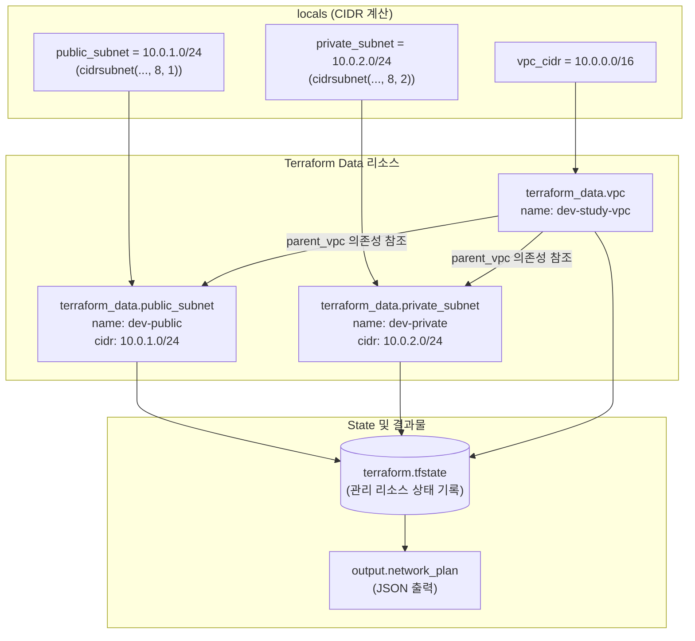

# 09단계: Terraform Infrastructure Lifecycle Lab (IaC)

## 1. 개요 및 학습 목표
- **학습 주제**: Terraform 기초, IaC(코드로서의 인프라), `terraform_data` 리소스, HCL(HashiCorp Configuration Language), State 관리, 멱등성(Idempotency), `terraform test`
- **비용**: 0원 (내장 `terraform_data` 리소스를 활용한 100% 로컬 시뮬레이션)
- **목표**:
  1. 클라우드 인프라 자원을 코드로 선언하고 버전 관리하는 IaC의 기본 철학을 학습합니다.
  2. `init` → `fmt` → `validate` → `test` → `plan` → `apply` → `destroy`에 이르는 Terraform의 전체 라이프사이클을 실습합니다.
  3. `terraform.tfstate` 파일이 리소스 변경 사항을 추적하는 메커니즘과, 동일 설정을 재실행했을 때 아무런 변경이 발생하지 않는 멱등성을 체득합니다.

---

## 2. 프로젝트 파일 구성
```text
09-terraform-iac/
├── main.tf                    # 논리적 VPC, Public Subnet, Private Subnet 선언
├── variables.tf               # 환경(environment) 변수 및 유효성 검사 규칙
├── outputs.tf                 # 네트워크 계획 출력값 정의 (network_plan)
├── .gitignore                 # .terraform/, *.tfstate, *.tfplan 등 Git 제외 규칙
├── tests/
│   └── network.tftest.hcl     # 3대 자동화 테스트 (CIDR 계산, VPC 의존성, prod 레이블)
├── docs/
│   └── learning-log.md        # 단계별 실행 결과 및 학습 기록
└── README.md                  # 09단계 실습 안내서
```

---

## 3. Terraform 리소스 구조 및 의존성 관계



---

## 4. Mac zsh 실행 명령어 가이드

```zsh
cd 09-terraform-iac

# 1. 작업 디렉터리 초기화
terraform init

# 2. 코드 서식 및 문법 검증
terraform fmt -check -recursive
terraform validate

# 3. 자동화 테스트 실행 (3건 검증)
terraform test

# 4. 변경 계획 계산 및 저장
terraform plan -out=study.tfplan

# 5. 인프라 계획 적용 (State 생성)
terraform apply study.tfplan

# 6. 관리 중인 리소스 목록 및 출력값 확인
terraform state list
terraform output -json network_plan

# 7. 멱등성 검증 (변경 사항 없음 확인)
terraform plan

# 8. 리소스 정리 (Destroy)
terraform destroy -auto-approve
terraform state list
```
