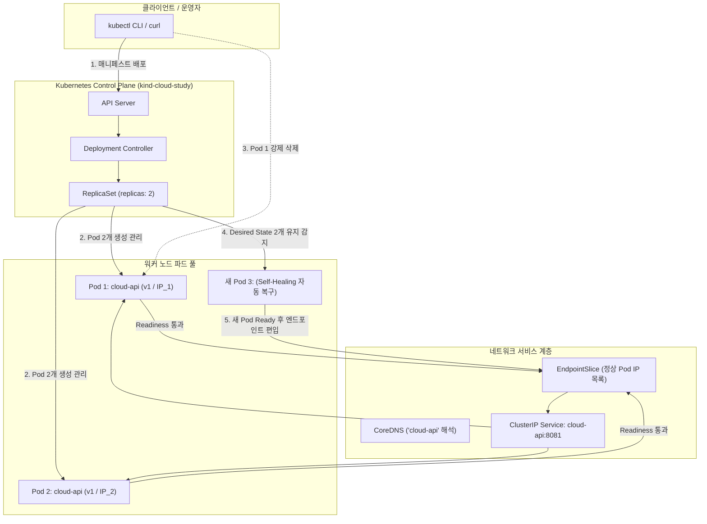

# 10단계: Kubernetes Deployment & Self-Healing Lab

## 1. 개요 및 학습 목표
- **학습 주제**: Kubernetes(K8s) 기초, Pod, Deployment, ReplicaSet, ClusterIP Service, 자가 치유(Self-Healing), 롤링 업데이트(Rolling Update), 무중단 배포
- **비용**: 0원 (로컬 kind 클러스터 및 Docker Desktop 기반)
- **목표**:
  1. Python HTTP 서버를 컨테이너 이미지(`cloud-api:v1`)로 빌드하여 kind 로컬 Kubernetes 클러스터에 Pod 2개(`replicas: 2`)로 배포합니다.
  2. ClusterIP Service(`cloud-api:8081`)를 통해 클러스터 내부에서 안정적인 부하 분산과 내장 DNS 탐색을 확인합니다.
  3. Pod 하나를 임의로 강제 삭제(`kubectl delete pod`)했을 때 Deployment Controller가 즉시 새로운 Pod를 생성해 원하는 복제 수(Desired State)를 복구하는 자가 치유(Self-Healing)를 검증합니다.
  4. 새로운 버전(`cloud-api:v2`)으로 롤링 업데이트 시 무중단으로 점진적 교체가 일어나는 과정을 검증합니다.

---

## 2. 프로젝트 파일 구성
```text
10-kubernetes-lab/
├── app/
│   ├── main.py                # 버전 환경변수(APP_VERSION)를 지원하는 HTTP 서버
│   └── Dockerfile             # 비루트 권한(USER 65534) 컨테이너 이미지 명세
├── k8s/
│   ├── deployment.yaml        # Deployment (replicas: 2, readinessProbe, 롤링 전략)
│   └── service.yaml           # ClusterIP Service (cloud-api:8081 -> target: 8081)
├── tests/
│   └── test_app.py            # 자동화 단위 테스트 (/health 200, / 200, /missing 404)
├── docs/
│   └── learning-log.md        # 배포 및 자가치유/롤링업데이트 검증 로그
├── verify.sh                  # 내부 DNS, 엔드포인트슬라이스, 헬스체크 종합 점검 스크립트
├── .gitignore
└── README.md                  # 10단계 실습 안내서
```

---

## 3. Kubernetes 아키텍처 및 컨트롤러 제어 루프



---

## 4. Mac zsh 실행 명령어 가이드

```zsh
cd 10-kubernetes-lab

# 1. 로컬 Python 단위 테스트
python3 -m unittest discover -s tests -p "test_*.py" -v

# 2. Docker 이미지 빌드 (v1)
docker build -t cloud-api:v1 ./app

# 3. kind 로컬 클러스터 생성 및 이미지 로드
kind create cluster --name cloud-study --wait 120s
kind load docker-image cloud-api:v1 --name cloud-study

# 4. Deployment 및 Service 배포
kubectl --context kind-cloud-study apply -f k8s/
kubectl --context kind-cloud-study rollout status deployment/cloud-api --timeout=120s

# 5. 내부 접근 및 검증 스크립트 실행
bash verify.sh

# 6. Pod 자가 치유(Self-Healing) 검증
POD=$(kubectl --context kind-cloud-study get pods -l app=cloud-api -o jsonpath='{.items[0].metadata.name}')
kubectl --context kind-cloud-study delete pod "$POD"
kubectl --context kind-cloud-study wait --for=jsonpath='{.status.readyReplicas}'=2 deployment/cloud-api --timeout=120s

# 7. 롤링 업데이트 (v2) 검증
docker build -t cloud-api:v2 ./app
kind load docker-image cloud-api:v2 --name cloud-study
kubectl --context kind-cloud-study set image deployment/cloud-api api=cloud-api:v2
kubectl --context kind-cloud-study set env deployment/cloud-api APP_VERSION=v2
kubectl --context kind-cloud-study rollout status deployment/cloud-api --timeout=120s

# 8. 클러스터 정리
kind delete cluster --name cloud-study
```
