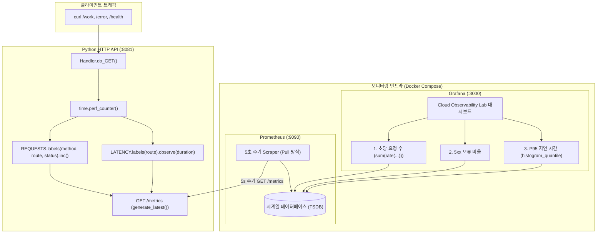

# 11단계: Cloud Observability Lab (Prometheus · Grafana)

## 1. 개요 및 학습 목표
- **학습 주제**: 클라우드 관측 가능성(Observability), Metrics/Logs/Traces 3대 축, Prometheus 메트릭 수집(Pull Scrape), Counter 및 Histogram, Grafana 대시보드 시각화, PromQL(RPS, Error Rate, P95 Latency)
- **비용**: 0원 (로컬 Docker Compose 기반)
- **목표**:
  1. Python HTTP API 서버에 Prometheus Python 클라이언트를 적용하여 누적 요청 수(`Counter`)와 응답 소요 시간(`Histogram`)을 수집하고 `/metrics` 엔드포인트로 노출합니다.
  2. Prometheus가 5초마다 API의 `/metrics`를 능동적으로 긁어오는(Scrape) 시계열 DB(TSDB) 파이프라인을 구축합니다.
  3. Grafana에서 데이터 소스와 대시보드를 코드로 자동 프로비저닝(Provisioning as Code)하여 RPS, 5xx 오류율, P95 응답 시간을 실시간 관측합니다.

---

## 2. 프로젝트 파일 구성
```text
11-observability-lab/
├── compose.yaml               # api, prometheus, grafana 3대 서비스 오케스트레이션
├── app/
│   ├── main.py                # Prometheus 메트릭 계측이 적용된 Python HTTP 서버
│   ├── requirements.txt       # prometheus-client 의존성
│   └── Dockerfile             # Python 3.11-slim 기반 컨테이너 이미지
├── prometheus/
│   └── prometheus.yml         # 5초 주기 스크랩 및 api:8081 수집 대상 정의
├── grafana/
│   ├── provisioning/
│   │   ├── datasources/prometheus.yml  # Prometheus 자동 연결 설정
│   │   └── dashboards/dashboard.yml   # 대시보드 프로바이더 설정
│   └── dashboards/cloud.json          # RPS, Error Rate, P95 Latency 대시보드 명세
├── tests/
│   └── test_app.py            # 자동화 단위 테스트 (4건 전수 검증)
├── docs/
│   └── learning-log.md        # 학습 및 테스트 결과 로그
├── .gitignore
└── README.md                  # 11단계 실습 안내서
```

---

## 3. 관측 가능성 아키텍처 및 메트릭 흐름



---

## 4. Mac zsh 실행 명령어 가이드

```zsh
cd 11-observability-lab

# 1. 로컬 Python 자동 단위 테스트 (4건)
python3 -m unittest discover -s tests -p 'test_*.py' -v

# 2. Docker Compose 빌드 및 백그라운드 기동
docker compose up -d --build
docker compose ps

# 3. API 엔드포인트 수동 검증
curl -i http://127.0.0.1:8081/health
curl -i http://127.0.0.1:8081/work
curl -i http://127.0.0.1:8081/error
curl -s http://127.0.0.1:8081/metrics | grep -E 'http_requests_total|http_request_duration_seconds'

# 4. 트래픽 부하 생성 (정상 60건, 오류 5건)
for i in $(seq 1 60); do curl -s -o /dev/null http://127.0.0.1:8081/work; done
for i in $(seq 1 5); do curl -s -o /dev/null http://127.0.0.1:8081/error; done

# 5. Prometheus Target 상태 확인
curl -s http://127.0.0.1:9090/api/v1/targets | grep -o '"health":"up"'

# 6. Grafana 대시보드 접근
# 웹 브라우저: http://localhost:3000 (admin / local-only-change-me)

# 7. 리소스 정리
docker compose down -v
```
