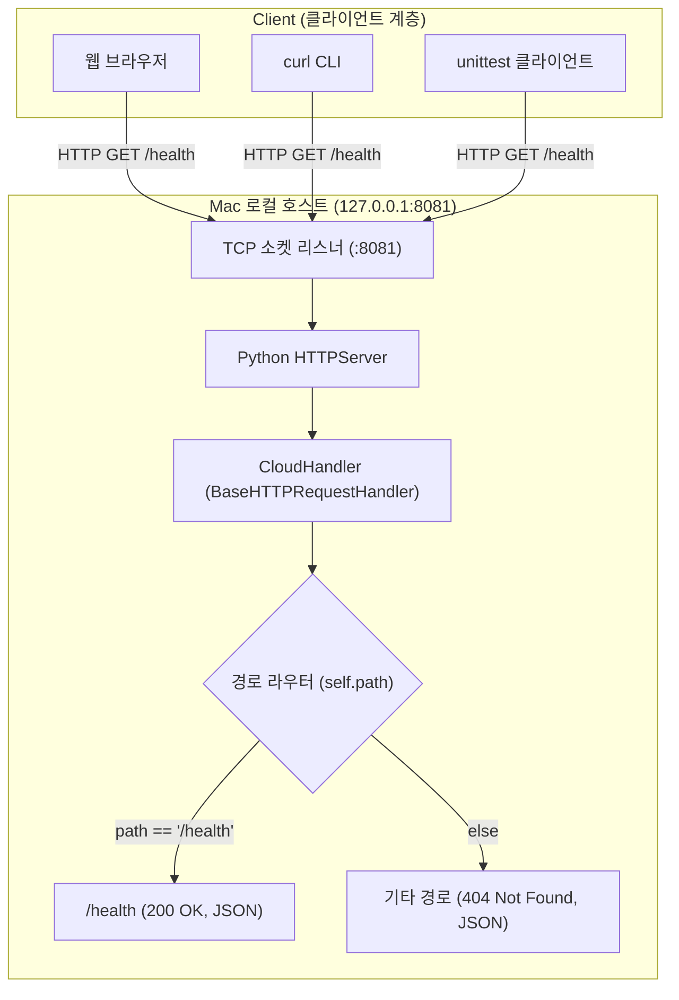
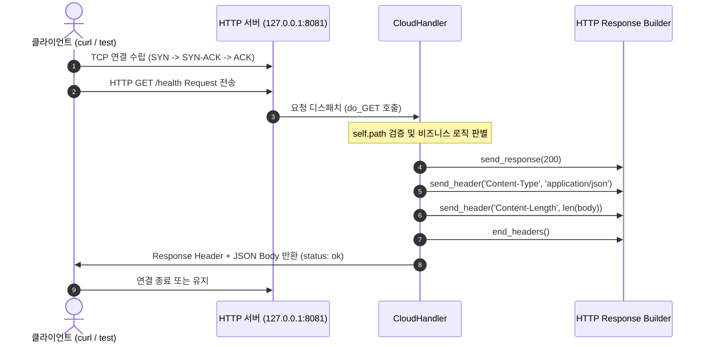

# 🏛️ Architecture & System Design Log (아키텍처 및 시스템 설계 이력)

이 문서는 클라우드 컴퓨팅 실습의 시스템 아키텍처, 네트워크 구성, 데이터 흐름 및 설계 결정(ADR)을 기록합니다.

---

## [2026-10-24] 01단계: 클라우드 기초 및 HTTP 서버 기본 아키텍처

### 1. 설계 목적
클라우드 인프라의 모든 통신(API 호출, Health Check, 서비스 간 통신)의 근간이 되는 **HTTP 클라이언트-서버 모델**과 **네트워크 소켓 바인딩 원리**를 Mac 로컬 환경에서 직접 검증합니다.

### 2. 시스템 아키텍처 다이어그램 (Mermaid)

### 3. 데이터 및 요청/응답 흐름 시퀀스 다이어그램 (Mermaid)

### 4. API 엔드포인트 명세
| Method | URI | Description | Status Code | Response Body |
| :---: | :--- | :--- | :---: | :--- |
| `GET` | `/health` | 서버 헬스체크 (상태 정상 여부 확인) | `200 OK` | `{"status": "ok", "service": "cloud-http-lab"}` |
| `GET` | `/missing` (또는 기타 모든 미등록 경로) | 존재하지 않는 리소스 요청 | `404 Not Found` | `{"error": "not_found"}` |
