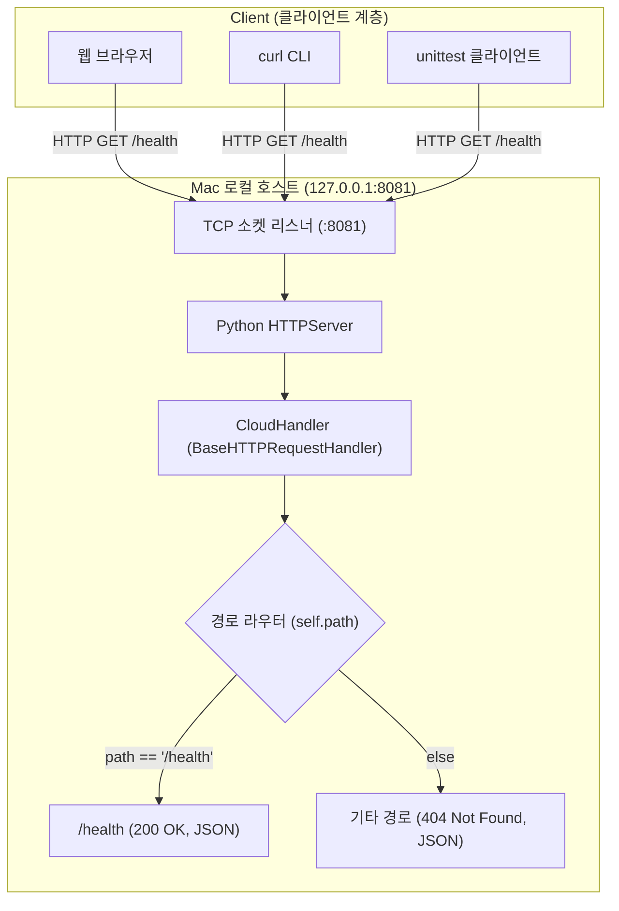
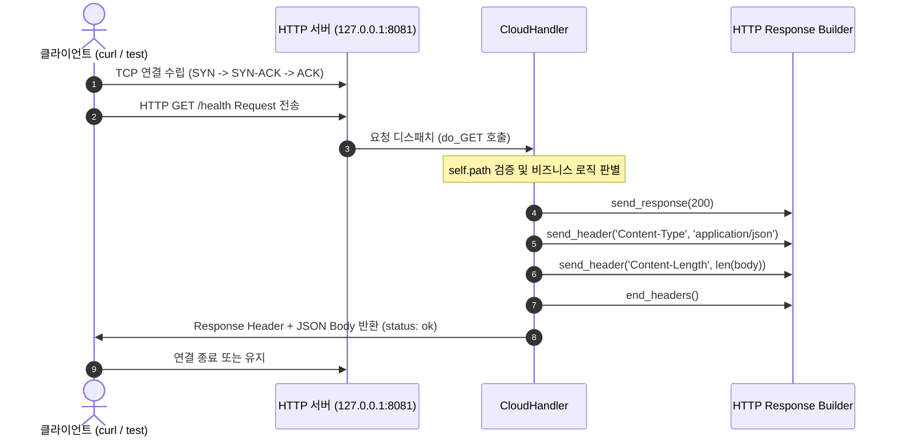
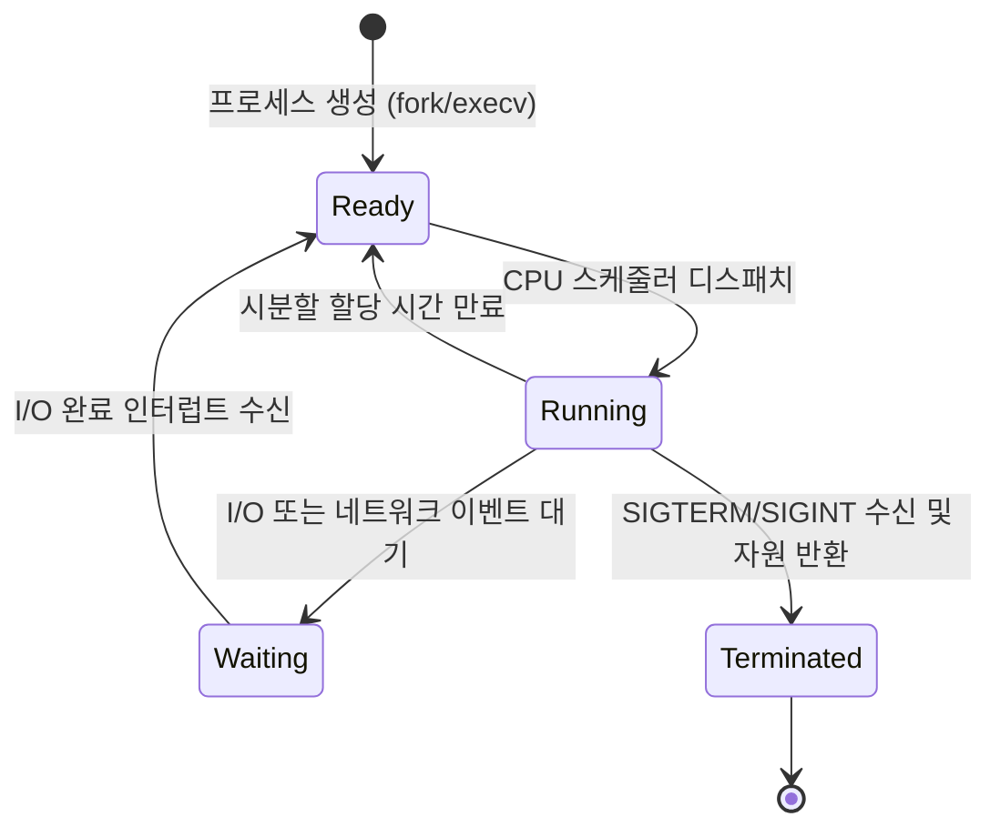
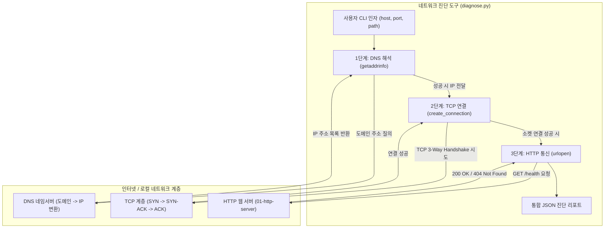
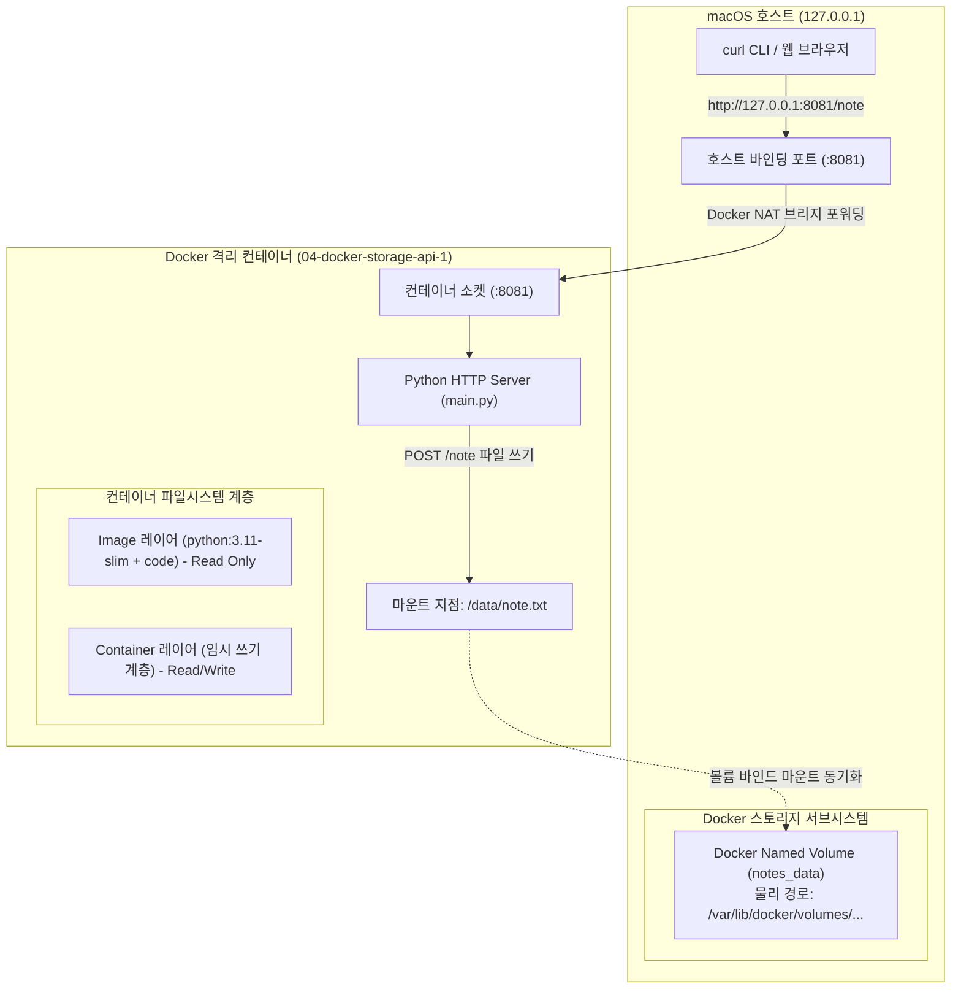
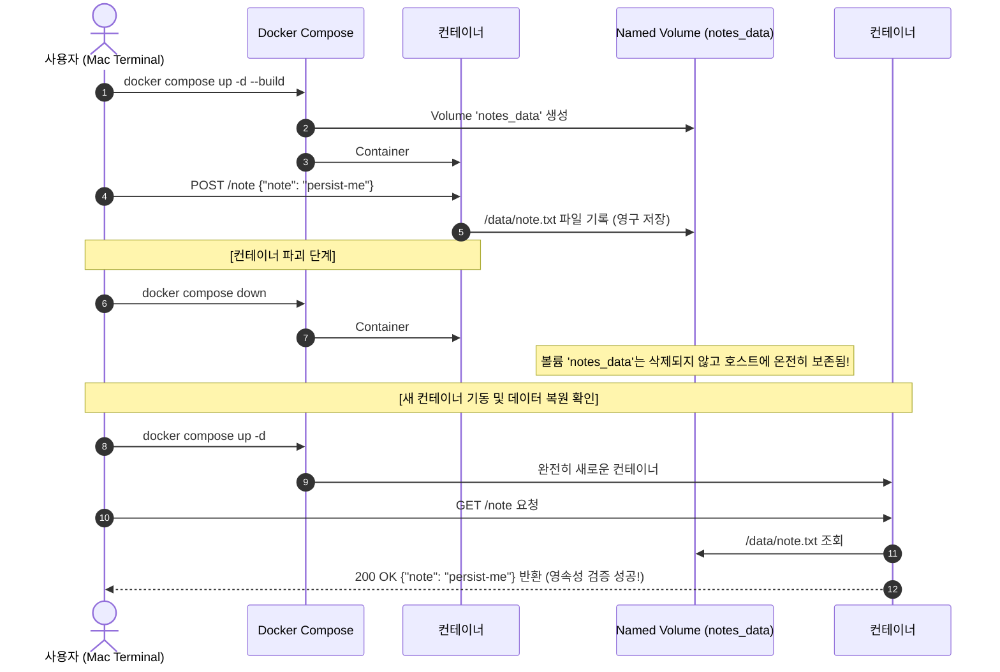

# 🏛️ Architecture & System Design Log (아키텍처 및 시스템 설계 이력)

이 문서는 클라우드 컴퓨팅 실습의 시스템 아키텍처, 네트워크 구성, 데이터 흐름 및 설계 결정(ADR)을 기록합니다.

---

## [2026-10-24] 01단계: 클라우드 기초 및 HTTP 서버 기본 아키텍처

### 1. 설계 목적
클라우드 인프라의 모든 통신(API 호출, Health Check, 서비스 간 통신)의 근간이 되는 **HTTP 클라이언트-서버 모델**과 **네트워크 소켓 바인딩 원리**를 Mac 로컬 환경에서 직접 검증합니다.

### 2. 시스템 아키텍처 다이어그램 (Mermaid)



### 3. 데이터 및 요청/응답 흐름 시퀀스 다이어그램 (Mermaid)



### 4. API 엔드포인트 명세
| Method | URI | Description | Status Code | Response Body |
| :---: | :--- | :--- | :---: | :--- |
| `GET` | `/health` | 서버 헬스체크 (상태 정상 여부 확인) | `200 OK` | `{"status": "ok", "service": "cloud-http-lab"}` |
| `GET` | `/missing` (또는 기타 모든 미등록 경로) | 존재하지 않는 리소스 요청 | `404 Not Found` | `{"error": "not_found"}` |

---

## [2026-10-24] 02단계: Linux 커널 자원 관리 및 서버 프로세스 모니터링 아키텍처

### 1. 설계 목적
클라우드 가상 머신(EC2) 또는 컨테이너(Docker/K8s) 내부에서 실행되는 서버 애플리케이션의 운영체제 자원 점유 구조(PID, PPID, CPU, RSS 메모리, STAT)를 추적하고, 시스템 호출 및 시그널(SIGTERM)을 통한 정상 종료 프로세스를 검증합니다.

### 2. 프로세스 라이프사이클 및 시스템 자원 상호작용 (Mermaid)

```mermaid
flowchart TD
    subgraph OSKernel ["운영체제 커널 (macOS / Linux Kernel)"]
        Scheduler["CPU 스케줄러 (시분할 다중화)"]
        MMU["가상 메모리 관리자 (RSS 상주 메모리)"]
        SocketTable["TCP 소켓 테이블 (:8081 LISTEN)"]
        ProcTable["프로세스 테이블 (PID, PPID, STAT)"]
    end

    subgraph ServerProcess ["HTTP 서버 프로세스 (PID: 55016)"]
        MainThread["메인 실행 스레드 (CloudHandler)"]
        MemoryHeap["Python 힙 메모리 (약 10.9MB)"]
    end

    subgraph MonitorTool ["프로세스 모니터 (monitor.py)"]
        SubprocessCall["subprocess.run('ps -p PID ...')"]
        Parser["출력 문자열 6필드 파싱 엔진"]
        JSONOutput["표준 JSON 출력 (running, cpu, rss)"]
    end

    ServerProcess -->|시스템 호출 (socket, bind)| SocketTable
    ServerProcess -->|메모리 할당 요청 (malloc)| MMU
    Scheduler -->|CPU 실행 시간 배분| MainThread
    SubprocessCall -->|커널 프로세스 테이블 조회| ProcTable
    ProcTable --> Parser
    Parser --> JSONOutput
```

### 3. 프로세스 생명주기 상태 전이도 (State Diagram)



---

## [2026-10-24] 03단계: TCP/IP · DNS · HTTP 계층형 네트워크 진단 아키텍처

### 1. 설계 목적
클라우드 인프라의 마이크로서비스 또는 클라이언트가 원격 서버와 통신할 때 거치는 **3대 네트워크 계층(DNS 주소 해석 → TCP 3-Way Handshake 세션 수립 → HTTP 요청/응답)**을 프로그래밍 방식으로 분리하여 장애 원인(도메인 미등록 vs 포트 미오픈/방화벽 vs 경로 404)을 정확하게 판별합니다.

### 2. 계층별 네트워크 진단 아키텍처 (Mermaid)



### 3. 계층별 장애 판별 매트릭스 (Troubleshooting Hierarchy)

| 진단 단계 | 점검 기술 | 성공 시 결과 | 실패 시 에러 및 원인 분석 |
| :---: | :---: | :--- | :--- |
| **1단계: DNS** | `socket.getaddrinfo()` | `ok: true`, IP 목록 반환 | `gaierror`: 잘못된 도메인명, 로컬 DNS 설정 오류 |
| **2단계: TCP** | `socket.create_connection()` | `ok: true`, 포트 연결 성공 | `ConnectionRefusedError`: 서버 프로세스 미구동, 방화벽 차단<br>`TimeoutError`: 네트워크 라우팅 지연, 패킷 드롭 |
| **3단계: HTTP** | `urllib.request.urlopen()` | `ok: true`, Status 200 | `HTTP 404`: 경로는 틀렸으나 네트워크 연결은 완벽히 정상<br>`HTTP 500`: 백엔드 서버 내부 애플리케이션 버그 |

---

## [2026-10-24] 04단계: 가상화 · Docker 컨테이너 격리 및 스토리지 영속성 아키텍처

### 1. 설계 목적
운영체제 레벨 가상화 기술인 Docker를 활용하여 01단계의 HTTP 서버를 불변(Immutable) 이미지로 패키징하고, 컨테이너 프로세스가 종료·삭제되어도 사용자 데이터(`note.txt`)가 보존되도록 **Docker Named Volume 마운트 아키텍처**를 구성 및 검증합니다.

### 2. Docker 포트 매핑 및 볼륨 마운트 구조 (Mermaid)



### 3. 컨테이너 삭제 및 재생성 시 데이터 영속성 라이프사이클




