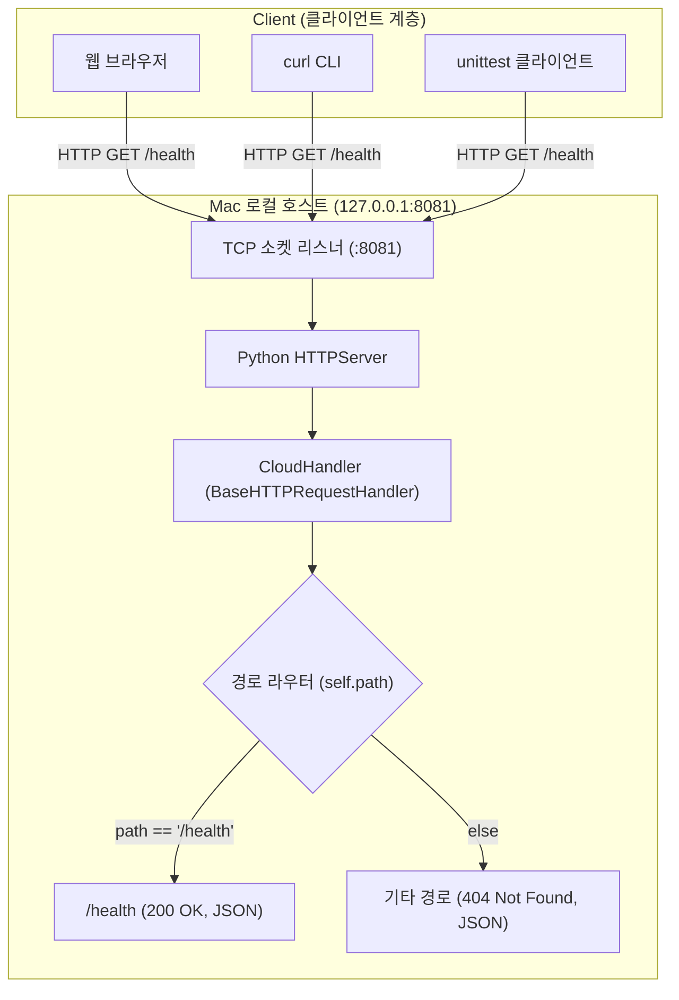
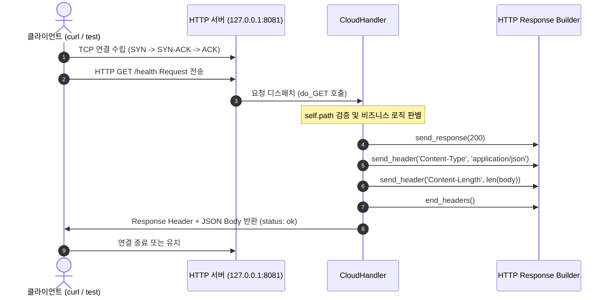
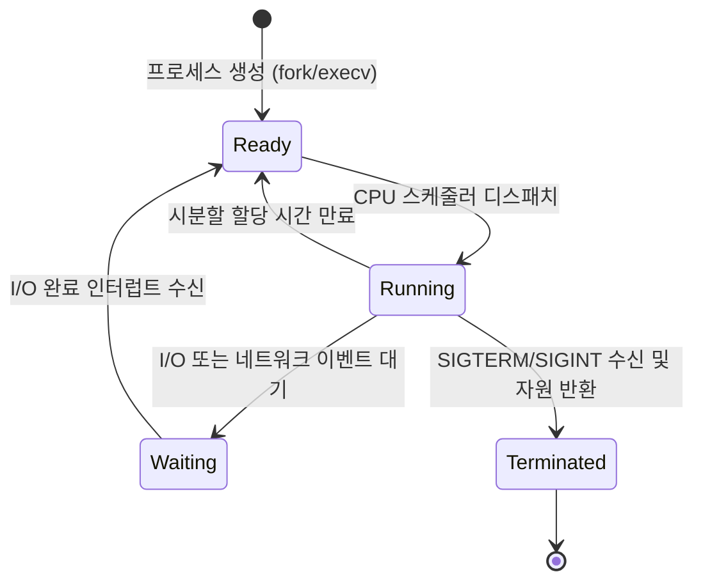
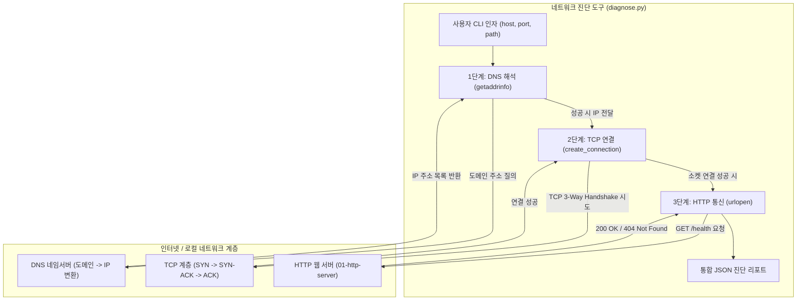
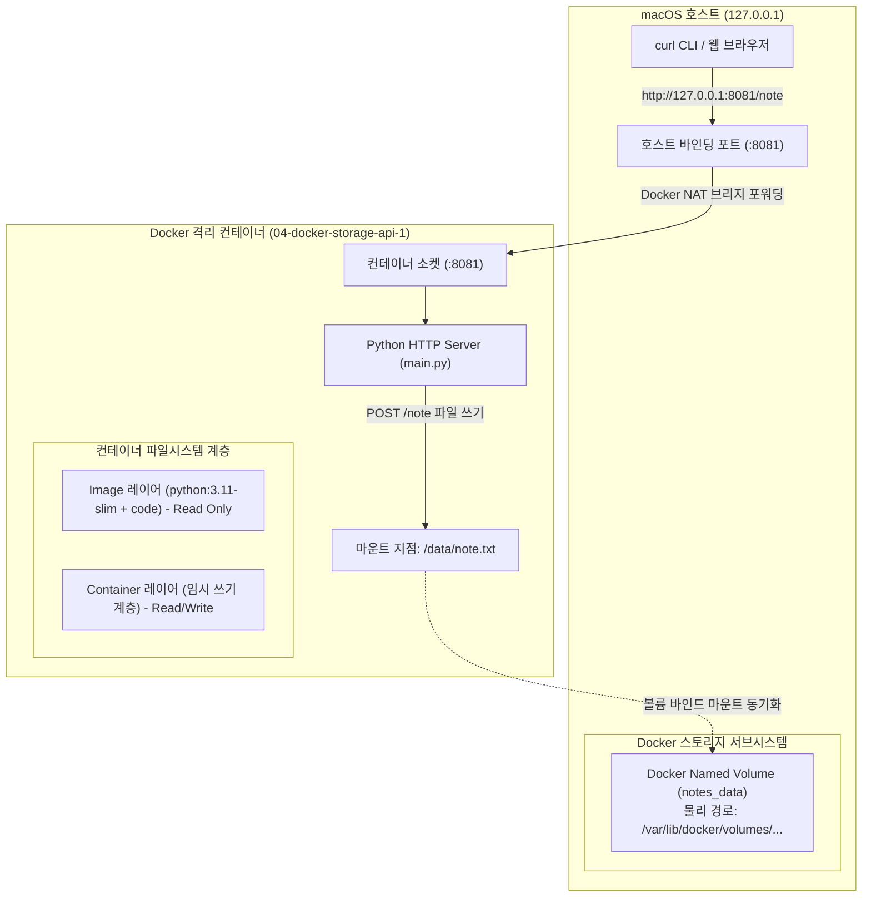
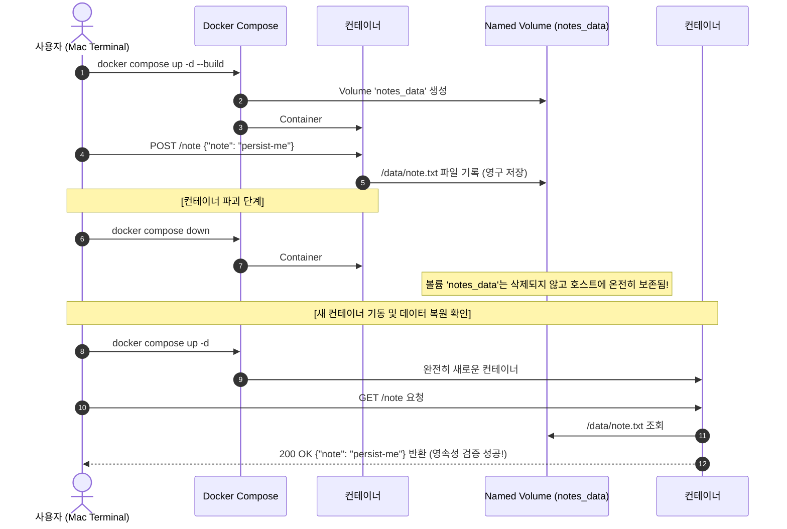
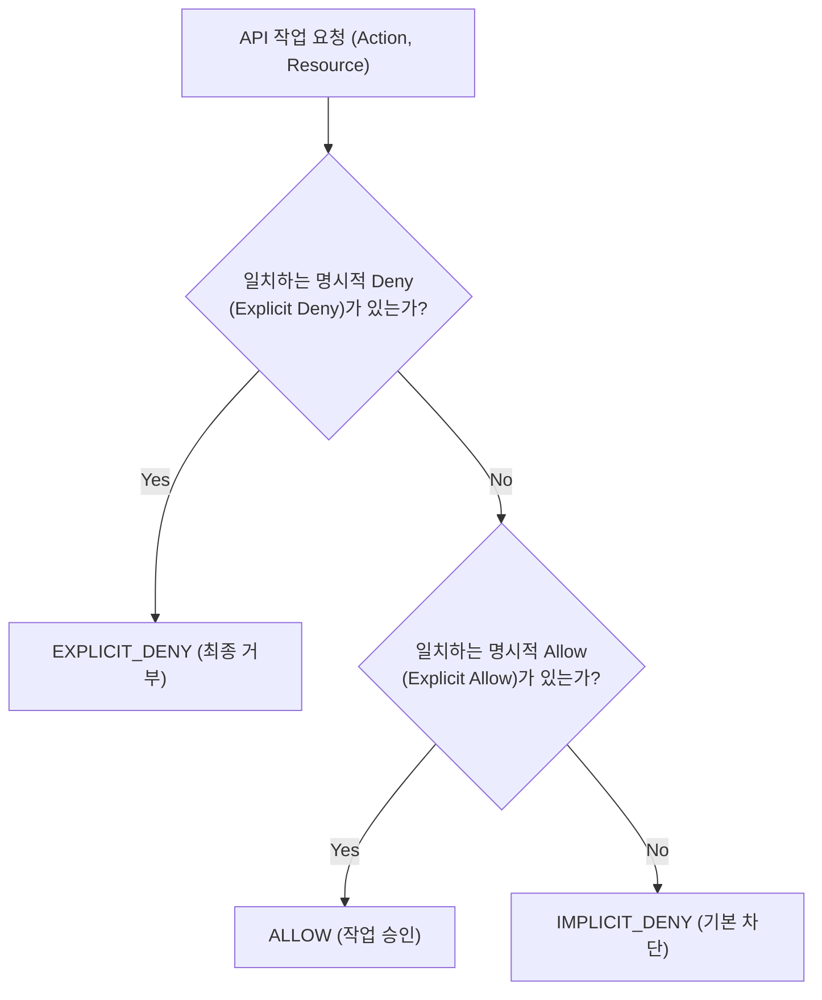
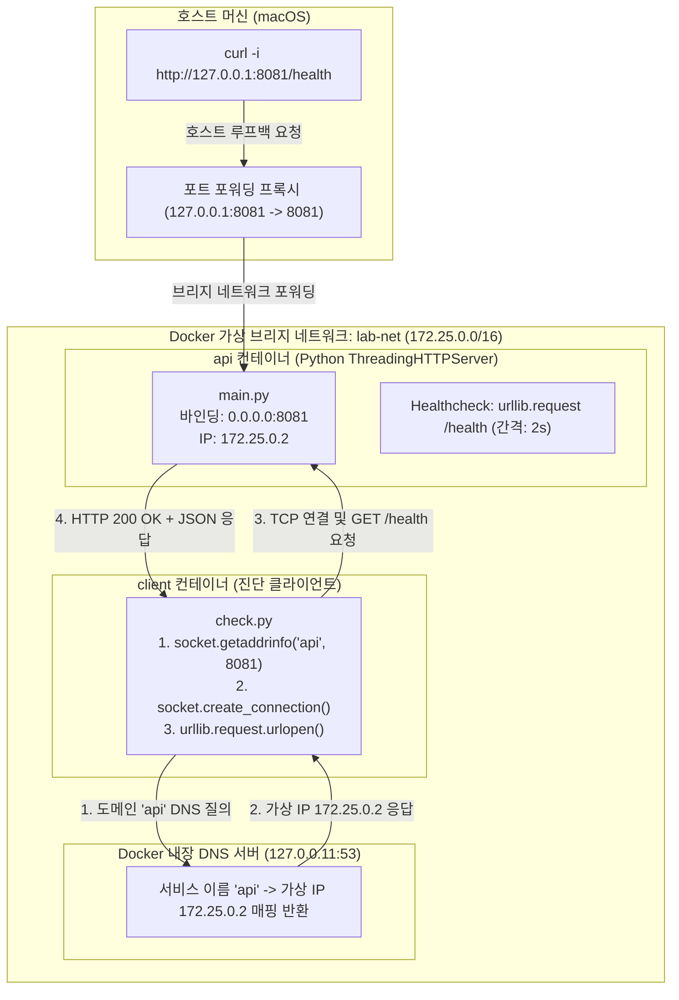
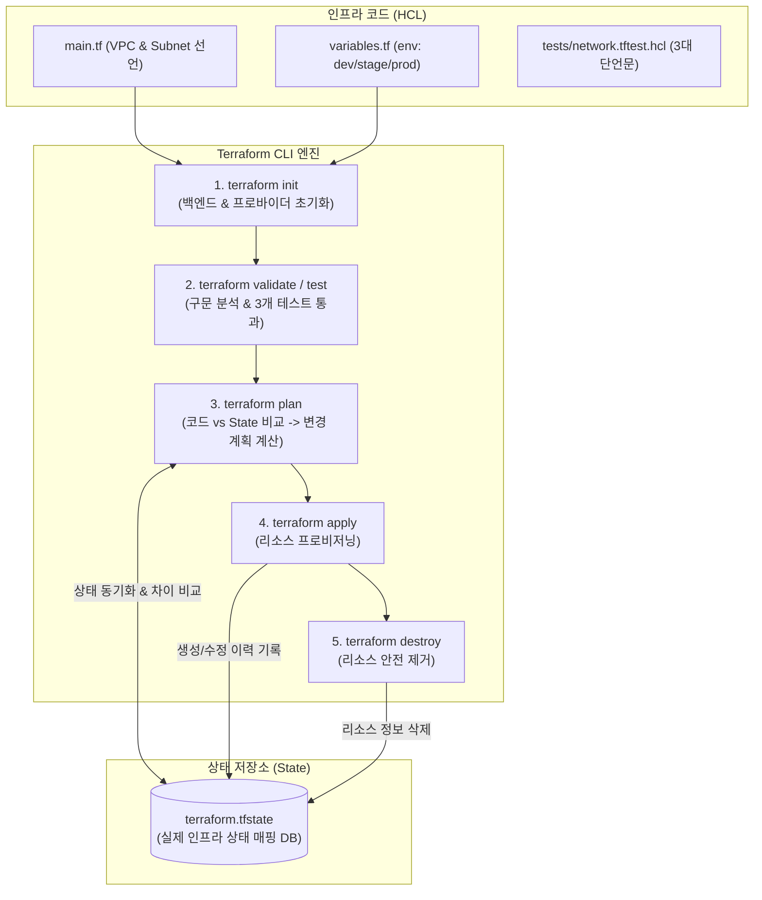
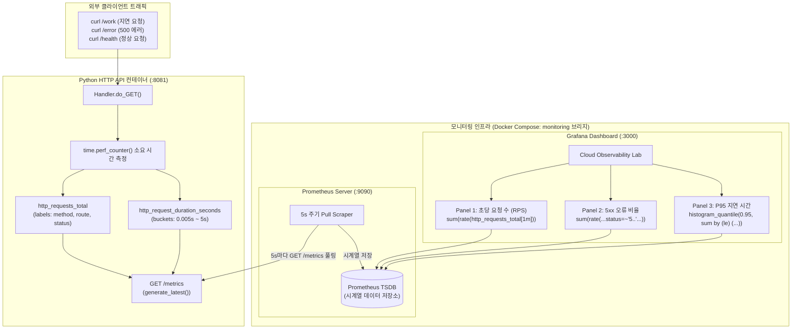

# 🏛️ Architecture & System Design Log (아키텍처 및 시스템 설계 이력)

이 문서는 클라우드 컴퓨팅 실습의 시스템 아키텍처, 네트워크 구성, 데이터 흐름 및 설계 결정(ADR)을 기록합니다.

---

## [2026-10-24] 01단계: 클라우드 기초 및 HTTP 서버 기본 아키텍처

### 1. 설계 목적
클라우드 인프라의 모든 통신(API 호출, Health Check, 서비스 간 통신)의 근간이 되는 **HTTP 클라이언트-서버 모델**과 **네트워크 소켓 바인딩 원리**를 Mac 로컬 환경에서 직접 검증합니다.

### 2. 시스템 아키텍처 다이어그램 (Mermaid)



### 3. 데이터 및 요청/응답 흐름 시퀀스 다이어그램 (Mermaid)



### 4. API 엔드포인트 명세
| Method | URI | Description | Status Code | Response Body |
| :---: | :--- | :--- | :---: | :--- |
| `GET` | `/health` | 서버 헬스체크 (상태 정상 여부 확인) | `200 OK` | `{"status": "ok", "service": "cloud-http-lab"}` |
| `GET` | `/missing` (또는 기타 모든 미등록 경로) | 존재하지 않는 리소스 요청 | `404 Not Found` | `{"error": "not_found"}` |

---

## [2026-10-24] 02단계: Linux 커널 자원 관리 및 서버 프로세스 모니터링 아키텍처

### 1. 설계 목적
클라우드 가상 머신(EC2) 또는 컨테이너(Docker/K8s) 내부에서 실행되는 서버 애플리케이션의 운영체제 자원 점유 구조(PID, PPID, CPU, RSS 메모리, STAT)를 추적하고, 시스템 호출 및 시그널(SIGTERM)을 통한 정상 종료 프로세스를 검증합니다.

### 2. 프로세스 라이프사이클 및 시스템 자원 상호작용 (Mermaid)

```mermaid
flowchart TD
    subgraph OSKernel ["운영체제 커널 (macOS / Linux Kernel)"]
        Scheduler["CPU 스케줄러 (시분할 다중화)"]
        MMU["가상 메모리 관리자 (RSS 상주 메모리)"]
        SocketTable["TCP 소켓 테이블 (:8081 LISTEN)"]
        ProcTable["프로세스 테이블 (PID, PPID, STAT)"]
    end

    subgraph ServerProcess ["HTTP 서버 프로세스 (PID: 55016)"]
        MainThread["메인 실행 스레드 (CloudHandler)"]
        MemoryHeap["Python 힙 메모리 (약 10.9MB)"]
    end

    subgraph MonitorTool ["프로세스 모니터 (monitor.py)"]
        SubprocessCall["subprocess.run('ps -p PID ...')"]
        Parser["출력 문자열 6필드 파싱 엔진"]
        JSONOutput["표준 JSON 출력 (running, cpu, rss)"]
    end

    ServerProcess -->|시스템 호출 (socket, bind)| SocketTable
    ServerProcess -->|메모리 할당 요청 (malloc)| MMU
    Scheduler -->|CPU 실행 시간 배분| MainThread
    SubprocessCall -->|커널 프로세스 테이블 조회| ProcTable
    ProcTable --> Parser
    Parser --> JSONOutput
```

### 3. 프로세스 생명주기 상태 전이도 (State Diagram)



---

## [2026-10-24] 03단계: TCP/IP · DNS · HTTP 계층형 네트워크 진단 아키텍처

### 1. 설계 목적
클라우드 인프라의 마이크로서비스 또는 클라이언트가 원격 서버와 통신할 때 거치는 **3대 네트워크 계층(DNS 주소 해석 → TCP 3-Way Handshake 세션 수립 → HTTP 요청/응답)**을 프로그래밍 방식으로 분리하여 장애 원인(도메인 미등록 vs 포트 미오픈/방화벽 vs 경로 404)을 정확하게 판별합니다.

### 2. 계층별 네트워크 진단 아키텍처 (Mermaid)



### 3. 계층별 장애 판별 매트릭스 (Troubleshooting Hierarchy)

| 진단 단계 | 점검 기술 | 성공 시 결과 | 실패 시 에러 및 원인 분석 |
| :---: | :---: | :--- | :--- |
| **1단계: DNS** | `socket.getaddrinfo()` | `ok: true`, IP 목록 반환 | `gaierror`: 잘못된 도메인명, 로컬 DNS 설정 오류 |
| **2단계: TCP** | `socket.create_connection()` | `ok: true`, 포트 연결 성공 | `ConnectionRefusedError`: 서버 프로세스 미구동, 방화벽 차단<br>`TimeoutError`: 네트워크 라우팅 지연, 패킷 드롭 |
| **3단계: HTTP** | `urllib.request.urlopen()` | `ok: true`, Status 200 | `HTTP 404`: 경로는 틀렸으나 네트워크 연결은 완벽히 정상<br>`HTTP 500`: 백엔드 서버 내부 애플리케이션 버그 |

---

## [2026-10-24] 04단계: 가상화 · Docker 컨테이너 격리 및 스토리지 영속성 아키텍처

### 1. 설계 목적
운영체제 레벨 가상화 기술인 Docker를 활용하여 01단계의 HTTP 서버를 불변(Immutable) 이미지로 패키징하고, 컨테이너 프로세스가 종료·삭제되어도 사용자 데이터(`note.txt`)가 보존되도록 **Docker Named Volume 마운트 아키텍처**를 구성 및 검증합니다.

### 2. Docker 포트 매핑 및 볼륨 마운트 구조 (Mermaid)



### 3. 컨테이너 삭제 및 재생성 시 데이터 영속성 라이프사이클



---

## [2026-10-24] 05단계: VPC 가상 사설망 · 서브넷 구획 및 라우팅 아키텍처

### 1. 설계 목적
클라우드 인프라의 근간인 **VPC(Virtual Private Cloud)** 논리망 구축, Public/Private 서브넷 격리 분할, 주소 중복 충돌 방지, 그리고 패킷 라우팅의 최우선 규칙인 **Longest Prefix Match(최장 접두사 일치)** 알고리즘을 파이썬 표준 라이브러리(`ipaddress`)로 모델링하여 검증합니다.

### 2. VPC 및 서브넷 라우팅 구조 (Mermaid)

```mermaid
flowchart TD
    subgraph VPC ["AWS Virtual Private Cloud (10.0.0.0/16) - 총 65,536개 IP"]
        subgraph PublicSubnet ["Public Subnet (10.0.1.0/24) - 가용 251개"]
            WebServer["웹 서버 인스턴스 (10.0.1.10)"]
        end

        subgraph PrivateSubnet ["Private Subnet (10.0.2.0/24) - 가용 251개"]
            Database["DB 인스턴스 (10.0.2.15)"]
        end

        subgraph RouteTable ["서브넷 라우트 테이블 (Longest Prefix Match)"]
            R1["10.0.2.0/24 -> Target: specific (우선순위 1위: /24)"]
            R2["10.0.0.0/16 -> Target: local (우선순위 2위: /16)"]
            R3["0.0.0.0/0 -> Target: igw (기본 경로: /0)"]
        end
    end

    InternetGateway["인터넷 게이트웨이 (IGW)"]
    PublicSubnet -->|인터넷 통신 (0.0.0.0/0)| RouteTable
    RouteTable -->|외부 공인 IP (예: 8.8.8.8)| InternetGateway
    RouteTable -->|내부 VPC 통신 (예: 10.0.3.15)| R2
    RouteTable -->|특정 전용 서브넷 통신 (예: 10.0.2.15)| R1
```

### 3. Longest Prefix Match 라우팅 매칭 매트릭스

| 목적지 IP | 매칭되는 라우트 후보들 | 선택된 최장 접두사 (Winner) | 최종 타깃 (Target) | 라우팅 결정 이유 |
| :---: | :--- | :---: | :---: | :--- |
| `10.0.2.15` | `0.0.0.0/0` (/0), `10.0.0.0/16` (/16), `10.0.2.0/24` (/24) | `10.0.2.0/24` | `specific` | 일치하는 규칙 중 서브넷 마스크 비트 길이가 가장 김 (/24) |
| `10.0.3.15` | `0.0.0.0/0` (/0), `10.0.0.0/16` (/16) | `10.0.0.0/16` | `local` | /24는 불일치, /0보다 더 구체적인 /16이 우선 적용됨 |
| `8.8.8.8` | `0.0.0.0/0` (/0) | `0.0.0.0/0` | `igw` | 내부 사설 IP가 아니므로 기본 경로(Default Gateway)로 전달 |

---

## [2026-10-24] 06단계: 클라우드 보안 3대 요소 (IAM · Security Group · NACL) 아키텍처

### 1. 설계 목적
클라우드 보안 거버넌스의 3대 축인 **IAM(API 제어 권한 평가)**, **Security Group(인스턴스 레벨 Stateful 방화벽)**, **NACL(서브넷 경계 Stateless 패킷 필터)**의 동작 메커니즘을 모델링하고, 명시적 거부 최우선 원칙 및 상태 저장/비저장 트래픽 제어를 검증합니다.

### 2. 클라우드 다계층 보안 방어선 구조 (Mermaid)

```mermaid
flowchart TD
    subgraph ClientLayer ["외부 클라이언트 (IP: 203.0.113.10)"]
        UserReq["HTTP 요청 (:8081)<br>출발지 임시포트: 55000"]
        UserResp["HTTP 응답 수신 (:55000)"]
    end

    subgraph SubnetBoundary ["서브넷 경계 보안 (Stateless)"]
        NaclIn{"NACL Inbound 규칙<br>낮은 번호순 평가 (Rule 100)"}
        NaclOut{"NACL Outbound 규칙<br>임시포트(1024~65535) 검사"}
    end

    subgraph InstanceBoundary ["인스턴스 경계 보안 (Stateful)"]
        SGIn{"Security Group Inbound<br>허용 규칙 집합 (Allow Only)"}
        SGConnTracker["연결 추적기 (Connection Tracker)<br>established=True 자동 허용"]
    end

    subgraph Workload ["웹 서버 워크로드 (:8081)"]
        HttpApp["Python HTTP Web Server"]
    end

    UserReq -->|1. 패킷 도착| NaclIn
    NaclIn -->|Rule 100 Allow| SGIn
    NaclIn -.->|일치 규칙 없음/Deny| Drop1["패킷 차단 (Drop)"]

    SGIn -->|허용 CIDR 일치| HttpApp
    SGIn -.->|규칙 없음| Drop2["패킷 차단 (Drop)"]

    HttpApp -->|2. 응답 패킷 전송| SGConnTracker
    SGConnTracker -->|Stateful: 별도 아웃바운드 규칙 불필요| NaclOut
    NaclOut -->|Rule 100 Allow (1024~65535)| UserResp
    NaclOut -.->|아웃바운드 미허용 시 (예: port 80)| Drop3["응답 패킷 차단 (Drop)"]
```

### 3. IAM 권한 평가 결정 트리 (Decision Tree)




---

## [2026-10-24] 07단계: Docker Multi-Container Networking & Service Discovery 아키텍처

### 1. 설계 목적
단일 컨테이너 실행 환경을 넘어 마이크로서비스 아키텍처의 핵심인 **컨테이너 간 격리된 사설 가상 네트워크(User-defined Bridge Network)**와 **이름 기반 주소 해석(Embedded DNS Service Discovery)**, 그리고 **선언적 헬스체크 기반 의존성(`condition: service_healthy`)**을 구성하고 통신 경로를 분리 검증합니다.

### 2. 멀티 컨테이너 네트워크 및 통신 경로 (Mermaid)



### 3. 통신 경로 및 보안 격리 비교

| 구분 | 호스트 접근 경로 | 컨테이너 내부 접근 경로 |
| :--- | :--- | :--- |
| **목적지 주소** | `http://127.0.0.1:8081/health` | `http://api:8081/health` |
| **주소 해석 방식** | 호스트 OS `/etc/hosts` 및 루프백 | Docker 내장 DNS (`127.0.0.11`) |
| **적용 보안 설정** | `ports: ["127.0.0.1:8081:8081"]` (로컬 루프백 한정) | `networks: [lab-net]` (동일 가상 브리지 내 격리) |
| **특징** | 외부 네트워크 노출 차단, 안전한 로컬 개발 | IP 변경 시에도 서비스 이름(`api`)으로 유연하게 결합 |


---

## [2026-10-24] 08단계: CI/CD Pipeline & GitHub Actions Automation 아키텍처

### 1. 설계 목적
개발자가 로컬에서 작성한 코드가 원격 저장소(`main` 브랜치)에 반영될 때마다 빌드·테스트를 수동으로 수행하지 않고, **GitHub Actions 클라우드 러너(Runner)를 통해 자동화된 품질 검증(CI)을 강제**하는 아키텍처를 수립합니다.
- **Fail-Fast 원칙**: Python 단위 테스트가 실패하면 리소스가 많이 소모되는 Docker 이미지 빌드 단계(`needs: python-tests`)로 진입하지 않고 즉시 파이프라인을 중단합니다.
- **최소 권한 원칙(Least Privilege)**: 워크플로 토큰 권한을 `permissions: contents: read`로 제한하여 잠재적인 보안 사고를 방지합니다.

### 2. CI 파이프라인 워크플로 구조 (Mermaid)

```mermaid
flowchart TD
    subgraph Trigger ["트리거 이벤트 (Triggers)"]
        PushEvent["git push origin main"]
        PREvent["Pull Request to main"]
        ManualEvent["workflow_dispatch (수동 트리거)"]
    end

    subgraph GitHubHostedRunner ["GitHub Actions 클라우드 환경 (ubuntu-latest)"]
        subgraph Job1 ["Job 1: python-tests"]
            StepCheckout1["actions/checkout@v6"]
            StepSetupPy["actions/setup-python@v6 (Python 3.11)"]
            StepTestApp["08-ci-actions/test_app.py 단위 테스트 (3건)"]
            StepTestNet["07-compose-network/test_local.py 단위 테스트 (3건)"]
        end

        subgraph Job2 ["Job 2: docker-build (needs: python-tests)"]
            StepCheckout2["actions/checkout@v6"]
            StepDockerBuild["docker build -t cloud-ci-lab:ci ./08-ci-actions"]
            StepSmokeTest["Smoke Test: 컨테이너 기동 및 헬스체크 폴링 (최대 25회)"]
            StepComposeBuild["07-compose-network compose build 검증"]
        end
    end

    PushEvent --> StepCheckout1
    PREvent --> StepCheckout1
    ManualEvent --> StepCheckout1

    StepCheckout1 --> StepSetupPy --> StepTestApp --> StepTestNet
    StepTestNet -->|성공 (Success)| StepCheckout2
    StepTestNet -.->|실패 (Fail)| Abort["파이프라인 즉시 중단 (Fail-Fast)"]

    StepCheckout2 --> StepDockerBuild --> StepSmokeTest --> StepComposeBuild
    StepComposeBuild --> PassResult["최종 CI 성공 (Green Check)"]
```

### 3. CI 파이프라인 구성 요소 비교 매트릭스

| 구성 요소 | 기술 스펙 | 핵심 역할 및 실무 의의 |
| :--- | :--- | :--- |
| **Workflow** | `cloud-ci.yml` | 전체 자동화 파이프라인의 생명주기와 실행 흐름을 선언하는 YAML 명세서 |
| **Runner** | `ubuntu-latest` | GitHub이 클라우드 상에서 일회성(Ephemeral)으로 프로비저닝하여 작업을 격리 실행하는 가상 머신 |
| **Job 1** | `python-tests` | 런타임 의존성 구성 및 단위 테스트를 수행하여 코드 로직의 결함을 1차 방어 |
| **Job 2** | `docker-build` | `needs: python-tests`로 선행 작업 통과 시에만 컨테이너 불변 이미지 패키징 및 스모크 테스트 수행 |
| **Permissions** | `contents: read` | 불필요한 쓰기/관리자 권한을 배제하여 토큰 탈취 시 저장소 변조 위협을 차단 |


---

## [2026-10-24] 09단계: Terraform Infrastructure as Code (IaC) 라이프사이클 아키텍처

### 1. 설계 목적
클라우드 인프라 자원을 웹 콘솔에서 수동 클릭으로 구성하던 전통적 방식에서 벗어나, 선언적 설정 언어(HCL)로 인프라의 형상을 코드로 정의하고 버전 관리하는 **Infrastructure as Code (IaC)** 패러다임을 확립합니다.
- **내장 시뮬레이션(`terraform_data`)**: 비용과 외부 인증 없이도 Terraform의 핵심 엔진(의존성 그래프 해석, State 생성/비교/갱신, 드리프트 감지, 멱등성)을 완전히 검증합니다.
- **의존성 그래프(Dependency Graph)**: 서브넷이 부모 VPC의 식별자(`terraform_data.vpc.input.name`)를 참조하여 생성 순서(VPC 생성 -> 서브넷 생성)를 스스로 판별하도록 유도합니다.

### 2. Terraform 실행 라이프사이클 및 State 관리 아키텍처 (Mermaid)



### 3. Terraform 핵심 개념 및 실무 매트릭스

| 개념 | 기술 요소 | 핵심 역할 및 실무 의미 |
| :--- | :--- | :--- |
| **HCL & locals** | `cidrsubnet(10.0.0.0/16, 8, 1)` | 수식과 함수를 통해 VPC 주소를 공용/사설 서브넷으로 자동 분할 계산 |
| **Dependency** | `parent_vpc = terraform_data.vpc...` | 명시적/암시적 참조를 통해 리소스 생성 및 삭제 순서(DAG 그래프)를 자동 결정 |
| **State** | `terraform.tfstate` | 코드와 실제 자원의 매핑 정보를 보관하는 진실의 원천(Source of Truth)으로 Git에 미포함 필수 |
| **Idempotency** | `No changes.` | 코드가 바뀌지 않았다면 여러 번 `apply`를 수행해도 시스템 상태가 불필요하게 변경되지 않는 성질 |
| **Automated Test** | `terraform test` | 실제 클라우드 과금 없이 `command = plan` 기반으로 CIDR 일치 및 환경 레이블을 검증 |


---

## [2026-10-24] 10단계: Kubernetes Architecture · Deployment · Service · Self-Healing 아키텍처

### 1. 설계 목적
단일 호스트 컨테이너 실행을 넘어, 분산 클라우드 환경에서 애플리케이션의 **원하는 상태(Desired State)**를 선언하고 이를 자율적으로 유지하는 **Kubernetes 컨테이너 오케스트레이션 아키텍처**를 수립합니다.
- **자가 치유 (Self-Healing)**: 장애나 인위적 삭제로 Pod가 비정상 종료되더라도 Deployment Controller와 ReplicaSet이 실시간으로 감지하여 새로운 Pod를 즉시 생성, 지정된 복제 수(`replicas: 2`)를 복구합니다.
- **안정적인 접근 지점 (ClusterIP Service)**: Pod가 생성/삭제될 때마다 내부 IP가 가변적으로 바뀌더라도, 클라이언트는 고정된 내부 도메인 이름(`cloud-api:8081`)을 통해 정상(Ready) 상태인 Pod 풀에 자동으로 부하 분산 접근합니다.
- **무중단 롤링 업데이트 (RollingUpdate)**: `maxSurge: 1`, `maxUnavailable: 0` 전략을 통해 구버전 Pod를 서비스에서 내리기 전에 신규 버전 Pod가 Readiness Probe를 먼저 통과하도록 보장함으로써 다운타임 없는 버전 업그레이드를 수행합니다.

### 2. Kubernetes 컨트롤러 루프 및 네트워킹 아키텍처 (Mermaid)

```mermaid
flowchart TD
    subgraph ControlPlane ["Kubernetes Control Plane (kind-cloud-study)"]
        APIServer["kube-apiserver"]
        DeployCtrl["Deployment Controller<br>(cloud-api)"]
        ReplicaSetCtrl["ReplicaSet Controller<br>(replicas: 2)"]
    end

    subgraph PodPool ["워커 노드 파드 풀 (Worker Node)"]
        Pod1["Pod 1: cloud-api-v1<br>(IP: 10.244.0.5)"]
        Pod2["Pod 2: cloud-api-v1<br>(IP: 10.244.0.6)"]
        NewPod["새 Pod 3: cloud-api-v1<br>(Self-Healing 자동 복구)"]
    end

    subgraph ServiceMesh ["서비스 추상화 계층"]
        CoreDNS["CoreDNS ('cloud-api' 해석)"]
        ClusterIPSvc["ClusterIP Service: cloud-api:8081<br>(Virtual IP: 10.96.23.57)"]
        EndpointSlice["EndpointSlice<br>[10.244.0.5, 10.244.0.6]"]
    end

    subgraph InternalClient ["클러스터 내부 워크로드"]
        BusyboxClient["busybox (wget http://cloud-api:8081/health)"]
    end

    APIServer --> DeployCtrl
    DeployCtrl --> ReplicaSetCtrl
    ReplicaSetCtrl -->|원하는 상태(2개) 유지| Pod1
    ReplicaSetCtrl -->|원하는 상태(2개) 유지| Pod2

    Pod1 -->|Readiness Probe /health 통과| EndpointSlice
    Pod2 -->|Readiness Probe /health 통과| EndpointSlice
    EndpointSlice --> ClusterIPSvc

    BusyboxClient -->|1. 도메인 'cloud-api' 질의| CoreDNS
    CoreDNS -->|2. ClusterIP 반환| BusyboxClient
    BusyboxClient -->|3. HTTP 8081 요청| ClusterIPSvc
    ClusterIPSvc -->|4. 부하 분산 라우팅| Pod1
    ClusterIPSvc -->|4. 부하 분산 라우팅| Pod2

    Pod1 -.->|강제 삭제 (kubectl delete)| Terminate["Pod 종료"]
    ReplicaSetCtrl -->|Desired State 미달 감지| NewPod
    NewPod -->|Readiness 통과 후 엔드포인트 갱신| EndpointSlice
```

### 3. Kubernetes 리소스 및 컨트롤러 역할 매트릭스

| 리소스 | 기술 스펙 | 핵심 역할 및 실무 의미 |
| :--- | :--- | :--- |
| **Pod** | `app/main.py` (비루트 65534) | Kubernetes의 가장 작은 배포 단위로, 하나 이상의 컨테이너와 네트워크 네임스페이스를 공유 |
| **Deployment** | `replicas: 2`, `RollingUpdate` | 선언적 방식으로 Pod의 복제 수, 버전 롤아웃 및 롤백을 총괄 관리하는 상위 컨트롤러 |
| **ReplicaSet** | `cloud-api-7d4cd7d87d` | Deployment가 생성한 저수준 컨트롤러로, 항상 정확히 N개의 Pod가 실행 중인지 감시 |
| **Readiness Probe** | `httpGet: /health`, `period: 2s` | 컨테이너가 트래픽을 처리할 준비가 되었는지 검사하여, 실패 시 엔드포인트에서 임시 제외 |
| **ClusterIP Service** | `port: 8081`, `targetPort: 8081` | 클러스터 내부 사설 가상 IP 및 DNS 이름을 제공하여 Pod IP 교체에도 무중단 통신 보장 |
| **EndpointSlice** | `discovery.k8s.io` | Service와 매핑된 정상 Pod IP 목록을 대규모 클러스터에서도 효율적으로 분산 추적 |


---

## [2026-10-24] 11단계: Cloud Observability & Prometheus · Grafana 모니터링 아키텍처

### 1. 설계 목적
분산 클라우드 환경에서 시스템 내부의 블랙박스 상태를 투명하게 관찰할 수 있도록, **관측 가능성 3요소(Metrics, Logs, Traces)** 중 핵심인 시계열 메트릭 파이프라인을 구축합니다.
- **표준 메트릭 노출 (`GET /metrics`)**: 애플리케이션 내부에서 `Counter`(누적 요청/오류 건수)와 `Histogram`(응답 지연 시간 분포)을 기록하고 Prometheus 오픈 표준 텍스트 포맷으로 노출합니다.
- **능동적 수집 (Pull Model)**: Prometheus가 5초마다 API 엔드포인트를 호출(Scrape)하여 시계열 데이터베이스(TSDB)에 수집·저장합니다.
- **코드 기반 프로비저닝 (Provisioning as Code)**: Grafana의 데이터소스(`Prometheus`)와 대시보드(`cloud.json`)를 수동 클릭 없이 YAML/JSON 코드로 자동 구성하여 RPS, 5xx 오류율, P95 레이턴시를 실시간 시각화합니다.

### 2. 관측 가능성 파이프라인 및 데이터 흐름 (Mermaid)



### 3. 핵심 3대 골든 시그널(Golden Signals) 매트릭스

| 지표 | 수집 메트릭 | PromQL 쿼리 | 실무 분석 의의 |
| :--- | :--- | :--- | :--- |
| **요청량 (Traffic)** | `http_requests_total` | `sum(rate(http_requests_total[1m]))` | 시스템에 유입되는 초당 요청 수(RPS) 변화 및 트래픽 폭주 감지 |
| **오류율 (Errors)** | `http_requests_total{status=~"5.."}` | `sum(rate(...status=~"5.."..)) / rate(total..)` | 서비스 장애 및 백엔드 예외 발생 빈도를 백분율로 추적하여 경보(Alert) 발송 |
| **지연 시간 (Latency)** | `http_request_duration_seconds` | `histogram_quantile(0.95, sum by (le) (rate(...)))` | 전체 사용자 중 95%가 체감하는 응답 지연 한계선(P95)을 측정하여 병목 구간 탐지 |
