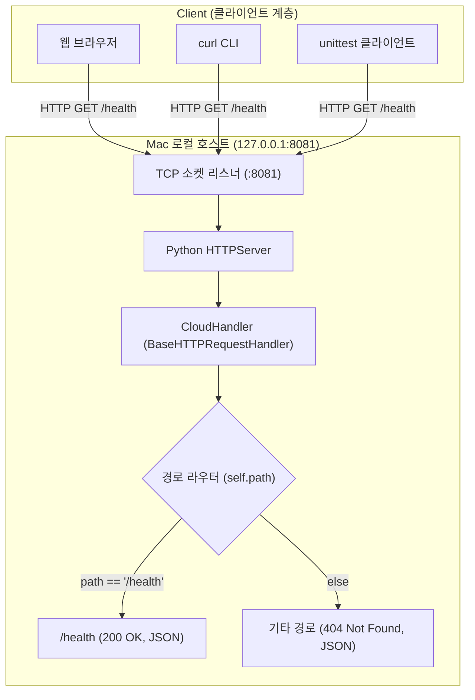
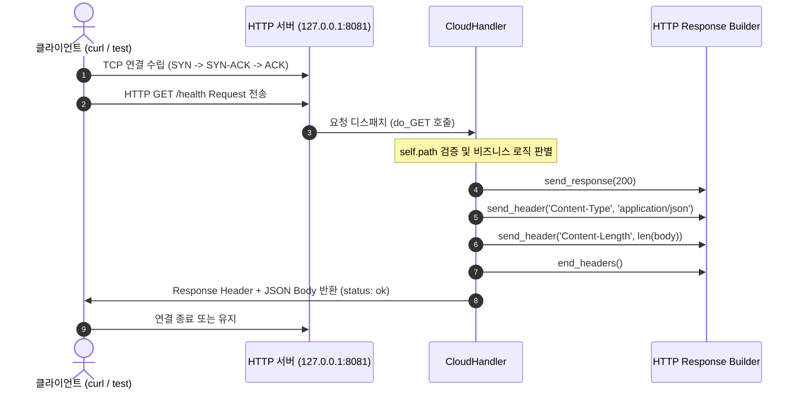
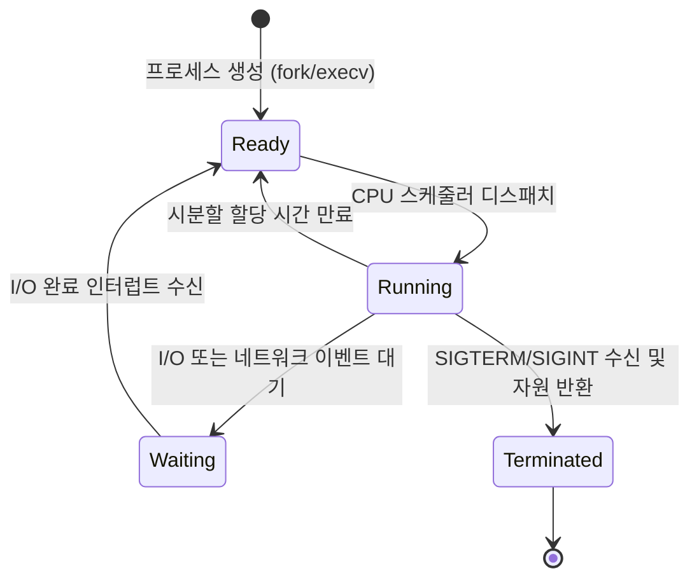
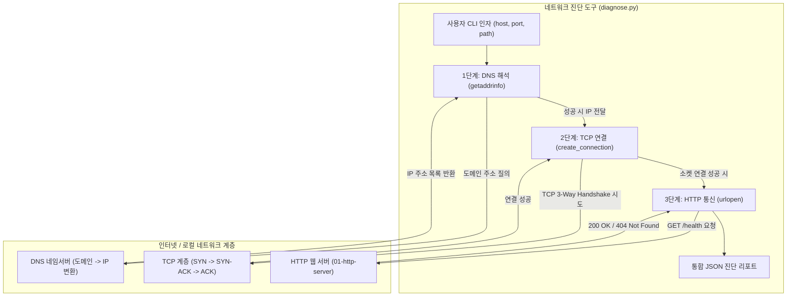
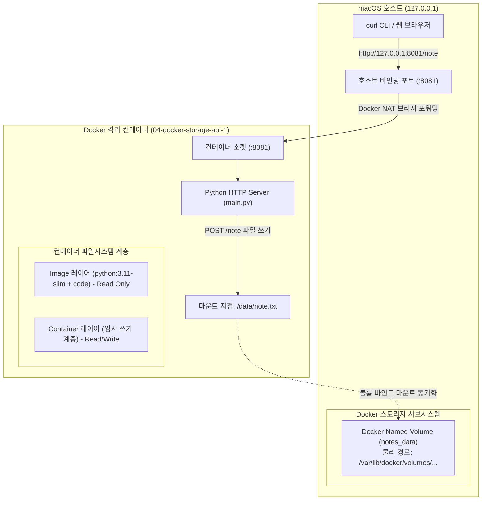
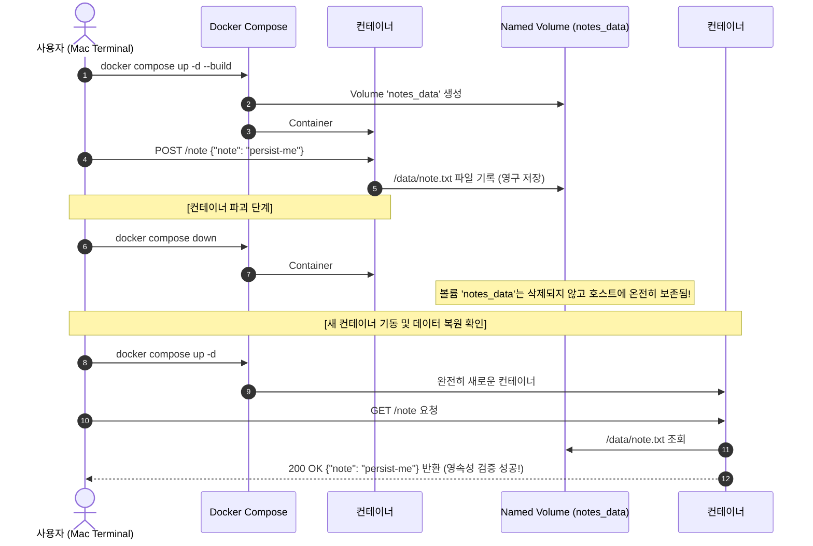
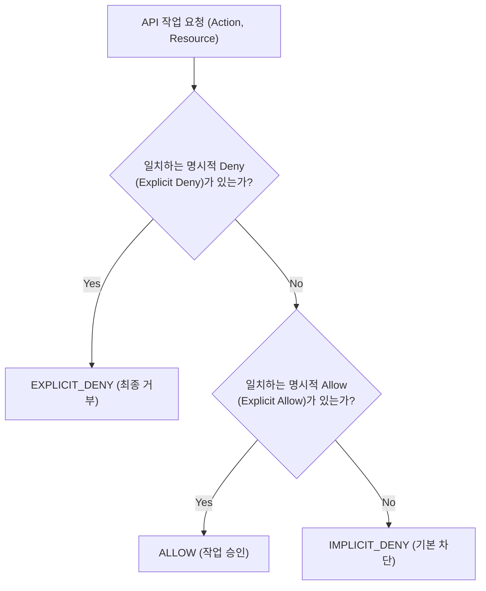

# 🏛️ Architecture & System Design Log (아키텍처 및 시스템 설계 이력)

이 문서는 클라우드 컴퓨팅 실습의 시스템 아키텍처, 네트워크 구성, 데이터 흐름 및 설계 결정(ADR)을 기록합니다.

---

## [2026-10-24] 01단계: 클라우드 기초 및 HTTP 서버 기본 아키텍처

### 1. 설계 목적
클라우드 인프라의 모든 통신(API 호출, Health Check, 서비스 간 통신)의 근간이 되는 **HTTP 클라이언트-서버 모델**과 **네트워크 소켓 바인딩 원리**를 Mac 로컬 환경에서 직접 검증합니다.

### 2. 시스템 아키텍처 다이어그램 (Mermaid)



### 3. 데이터 및 요청/응답 흐름 시퀀스 다이어그램 (Mermaid)



### 4. API 엔드포인트 명세
| Method | URI | Description | Status Code | Response Body |
| :---: | :--- | :--- | :---: | :--- |
| `GET` | `/health` | 서버 헬스체크 (상태 정상 여부 확인) | `200 OK` | `{"status": "ok", "service": "cloud-http-lab"}` |
| `GET` | `/missing` (또는 기타 모든 미등록 경로) | 존재하지 않는 리소스 요청 | `404 Not Found` | `{"error": "not_found"}` |

---

## [2026-10-24] 02단계: Linux 커널 자원 관리 및 서버 프로세스 모니터링 아키텍처

### 1. 설계 목적
클라우드 가상 머신(EC2) 또는 컨테이너(Docker/K8s) 내부에서 실행되는 서버 애플리케이션의 운영체제 자원 점유 구조(PID, PPID, CPU, RSS 메모리, STAT)를 추적하고, 시스템 호출 및 시그널(SIGTERM)을 통한 정상 종료 프로세스를 검증합니다.

### 2. 프로세스 라이프사이클 및 시스템 자원 상호작용 (Mermaid)

```mermaid
flowchart TD
    subgraph OSKernel ["운영체제 커널 (macOS / Linux Kernel)"]
        Scheduler["CPU 스케줄러 (시분할 다중화)"]
        MMU["가상 메모리 관리자 (RSS 상주 메모리)"]
        SocketTable["TCP 소켓 테이블 (:8081 LISTEN)"]
        ProcTable["프로세스 테이블 (PID, PPID, STAT)"]
    end

    subgraph ServerProcess ["HTTP 서버 프로세스 (PID: 55016)"]
        MainThread["메인 실행 스레드 (CloudHandler)"]
        MemoryHeap["Python 힙 메모리 (약 10.9MB)"]
    end

    subgraph MonitorTool ["프로세스 모니터 (monitor.py)"]
        SubprocessCall["subprocess.run('ps -p PID ...')"]
        Parser["출력 문자열 6필드 파싱 엔진"]
        JSONOutput["표준 JSON 출력 (running, cpu, rss)"]
    end

    ServerProcess -->|시스템 호출 (socket, bind)| SocketTable
    ServerProcess -->|메모리 할당 요청 (malloc)| MMU
    Scheduler -->|CPU 실행 시간 배분| MainThread
    SubprocessCall -->|커널 프로세스 테이블 조회| ProcTable
    ProcTable --> Parser
    Parser --> JSONOutput
```

### 3. 프로세스 생명주기 상태 전이도 (State Diagram)



---

## [2026-10-24] 03단계: TCP/IP · DNS · HTTP 계층형 네트워크 진단 아키텍처

### 1. 설계 목적
클라우드 인프라의 마이크로서비스 또는 클라이언트가 원격 서버와 통신할 때 거치는 **3대 네트워크 계층(DNS 주소 해석 → TCP 3-Way Handshake 세션 수립 → HTTP 요청/응답)**을 프로그래밍 방식으로 분리하여 장애 원인(도메인 미등록 vs 포트 미오픈/방화벽 vs 경로 404)을 정확하게 판별합니다.

### 2. 계층별 네트워크 진단 아키텍처 (Mermaid)



### 3. 계층별 장애 판별 매트릭스 (Troubleshooting Hierarchy)

| 진단 단계 | 점검 기술 | 성공 시 결과 | 실패 시 에러 및 원인 분석 |
| :---: | :---: | :--- | :--- |
| **1단계: DNS** | `socket.getaddrinfo()` | `ok: true`, IP 목록 반환 | `gaierror`: 잘못된 도메인명, 로컬 DNS 설정 오류 |
| **2단계: TCP** | `socket.create_connection()` | `ok: true`, 포트 연결 성공 | `ConnectionRefusedError`: 서버 프로세스 미구동, 방화벽 차단<br>`TimeoutError`: 네트워크 라우팅 지연, 패킷 드롭 |
| **3단계: HTTP** | `urllib.request.urlopen()` | `ok: true`, Status 200 | `HTTP 404`: 경로는 틀렸으나 네트워크 연결은 완벽히 정상<br>`HTTP 500`: 백엔드 서버 내부 애플리케이션 버그 |

---

## [2026-10-24] 04단계: 가상화 · Docker 컨테이너 격리 및 스토리지 영속성 아키텍처

### 1. 설계 목적
운영체제 레벨 가상화 기술인 Docker를 활용하여 01단계의 HTTP 서버를 불변(Immutable) 이미지로 패키징하고, 컨테이너 프로세스가 종료·삭제되어도 사용자 데이터(`note.txt`)가 보존되도록 **Docker Named Volume 마운트 아키텍처**를 구성 및 검증합니다.

### 2. Docker 포트 매핑 및 볼륨 마운트 구조 (Mermaid)



### 3. 컨테이너 삭제 및 재생성 시 데이터 영속성 라이프사이클



---

## [2026-10-24] 05단계: VPC 가상 사설망 · 서브넷 구획 및 라우팅 아키텍처

### 1. 설계 목적
클라우드 인프라의 근간인 **VPC(Virtual Private Cloud)** 논리망 구축, Public/Private 서브넷 격리 분할, 주소 중복 충돌 방지, 그리고 패킷 라우팅의 최우선 규칙인 **Longest Prefix Match(최장 접두사 일치)** 알고리즘을 파이썬 표준 라이브러리(`ipaddress`)로 모델링하여 검증합니다.

### 2. VPC 및 서브넷 라우팅 구조 (Mermaid)

```mermaid
flowchart TD
    subgraph VPC ["AWS Virtual Private Cloud (10.0.0.0/16) - 총 65,536개 IP"]
        subgraph PublicSubnet ["Public Subnet (10.0.1.0/24) - 가용 251개"]
            WebServer["웹 서버 인스턴스 (10.0.1.10)"]
        end

        subgraph PrivateSubnet ["Private Subnet (10.0.2.0/24) - 가용 251개"]
            Database["DB 인스턴스 (10.0.2.15)"]
        end

        subgraph RouteTable ["서브넷 라우트 테이블 (Longest Prefix Match)"]
            R1["10.0.2.0/24 -> Target: specific (우선순위 1위: /24)"]
            R2["10.0.0.0/16 -> Target: local (우선순위 2위: /16)"]
            R3["0.0.0.0/0 -> Target: igw (기본 경로: /0)"]
        end
    end

    InternetGateway["인터넷 게이트웨이 (IGW)"]
    PublicSubnet -->|인터넷 통신 (0.0.0.0/0)| RouteTable
    RouteTable -->|외부 공인 IP (예: 8.8.8.8)| InternetGateway
    RouteTable -->|내부 VPC 통신 (예: 10.0.3.15)| R2
    RouteTable -->|특정 전용 서브넷 통신 (예: 10.0.2.15)| R1
```

### 3. Longest Prefix Match 라우팅 매칭 매트릭스

| 목적지 IP | 매칭되는 라우트 후보들 | 선택된 최장 접두사 (Winner) | 최종 타깃 (Target) | 라우팅 결정 이유 |
| :---: | :--- | :---: | :---: | :--- |
| `10.0.2.15` | `0.0.0.0/0` (/0), `10.0.0.0/16` (/16), `10.0.2.0/24` (/24) | `10.0.2.0/24` | `specific` | 일치하는 규칙 중 서브넷 마스크 비트 길이가 가장 김 (/24) |
| `10.0.3.15` | `0.0.0.0/0` (/0), `10.0.0.0/16` (/16) | `10.0.0.0/16` | `local` | /24는 불일치, /0보다 더 구체적인 /16이 우선 적용됨 |
| `8.8.8.8` | `0.0.0.0/0` (/0) | `0.0.0.0/0` | `igw` | 내부 사설 IP가 아니므로 기본 경로(Default Gateway)로 전달 |

---

## [2026-10-24] 06단계: 클라우드 보안 3대 요소 (IAM · Security Group · NACL) 아키텍처

### 1. 설계 목적
클라우드 보안 거버넌스의 3대 축인 **IAM(API 제어 권한 평가)**, **Security Group(인스턴스 레벨 Stateful 방화벽)**, **NACL(서브넷 경계 Stateless 패킷 필터)**의 동작 메커니즘을 모델링하고, 명시적 거부 최우선 원칙 및 상태 저장/비저장 트래픽 제어를 검증합니다.

### 2. 클라우드 다계층 보안 방어선 구조 (Mermaid)

```mermaid
flowchart TD
    subgraph ClientLayer ["외부 클라이언트 (IP: 203.0.113.10)"]
        UserReq["HTTP 요청 (:8081)<br>출발지 임시포트: 55000"]
        UserResp["HTTP 응답 수신 (:55000)"]
    end

    subgraph SubnetBoundary ["서브넷 경계 보안 (Stateless)"]
        NaclIn{"NACL Inbound 규칙<br>낮은 번호순 평가 (Rule 100)"}
        NaclOut{"NACL Outbound 규칙<br>임시포트(1024~65535) 검사"}
    end

    subgraph InstanceBoundary ["인스턴스 경계 보안 (Stateful)"]
        SGIn{"Security Group Inbound<br>허용 규칙 집합 (Allow Only)"}
        SGConnTracker["연결 추적기 (Connection Tracker)<br>established=True 자동 허용"]
    end

    subgraph Workload ["웹 서버 워크로드 (:8081)"]
        HttpApp["Python HTTP Web Server"]
    end

    UserReq -->|1. 패킷 도착| NaclIn
    NaclIn -->|Rule 100 Allow| SGIn
    NaclIn -.->|일치 규칙 없음/Deny| Drop1["패킷 차단 (Drop)"]

    SGIn -->|허용 CIDR 일치| HttpApp
    SGIn -.->|규칙 없음| Drop2["패킷 차단 (Drop)"]

    HttpApp -->|2. 응답 패킷 전송| SGConnTracker
    SGConnTracker -->|Stateful: 별도 아웃바운드 규칙 불필요| NaclOut
    NaclOut -->|Rule 100 Allow (1024~65535)| UserResp
    NaclOut -.->|아웃바운드 미허용 시 (예: port 80)| Drop3["응답 패킷 차단 (Drop)"]
```

### 3. IAM 권한 평가 결정 트리 (Decision Tree)




